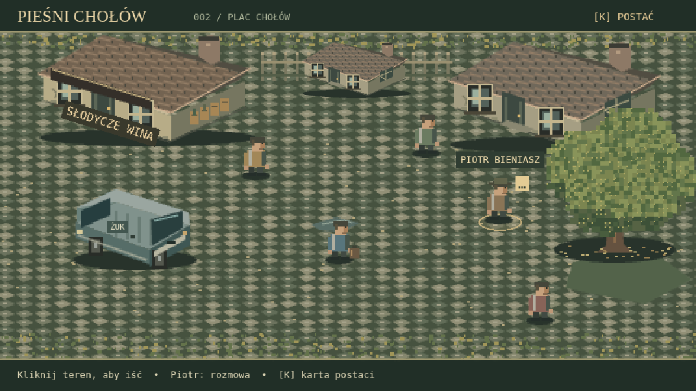
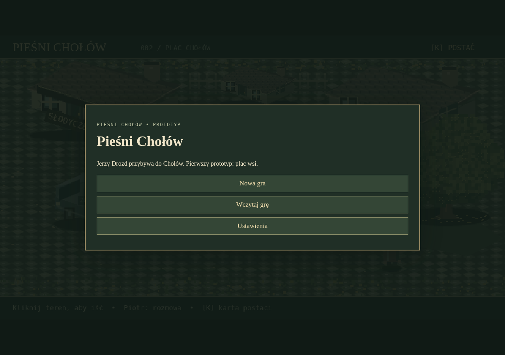
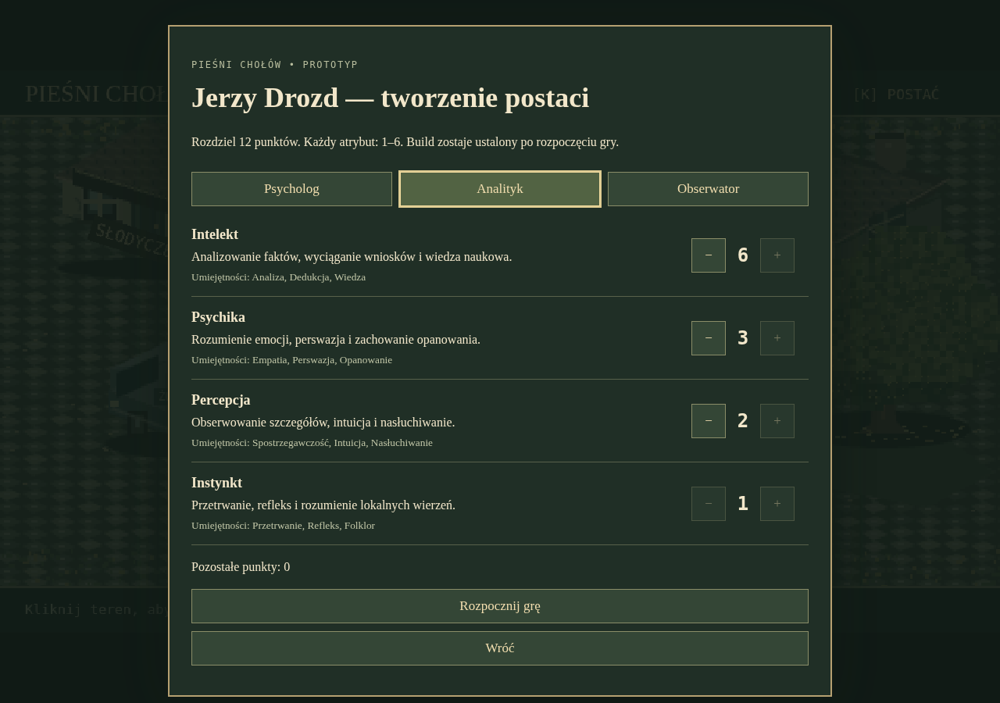
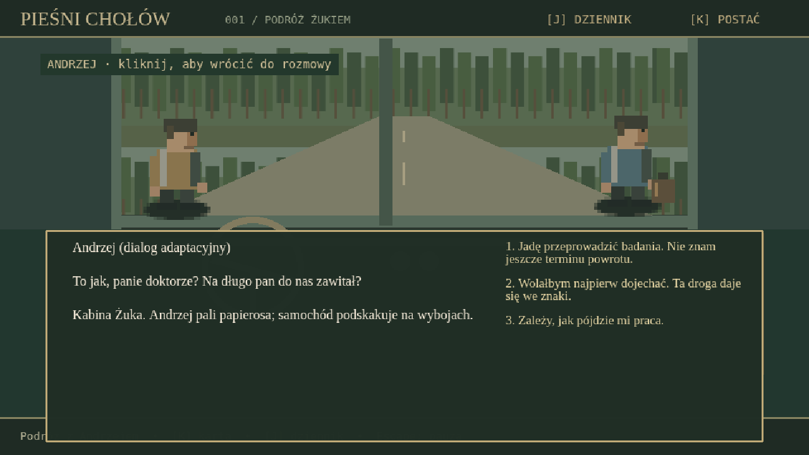
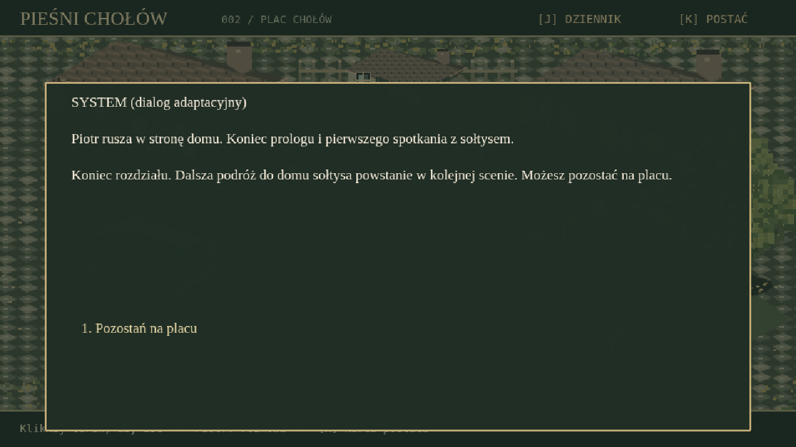

# Pieśni Chołów — gra przeglądarkowa

Prototyp izometrycznego, fabularnego RPG point-and-click inspirowanego powieścią **„Pieśni Chołów”** Macieja Głowackiego.

## Uruchomienie
Wymagany Node.js 20+.

```bash
npm install
npm run dev
```

Otwórz adres podany przez Vite. Budowanie produkcyjne: `npm run build`.

## Stan
Wersja **0.1 — techniczny vertical slice**, nie kompletne demo. Zawiera grywalną podróż Żukiem z Andrzejem, plac Chołów, ruch myszą, spotkanie z Piotrem, dialogi z PR #3 i jawne rzuty 2k6. Grafika to lokalne, proceduralne placeholdery pixel art; ścieżka dialogowa jest tekstem projektowym, nie cytatem z powieści.

## Docelowe demo
1. Podróż Żukiem i rozmowa z Andrzejem
2. Plac Chołów i Piotr Bieniasz
3. Dom Bieniasza
4. Dom Romana, Łucja i piwnica

Dokumenty produkcyjne: `docs/GDD.md`, `docs/SCENES.md`, `AGENTS.md`.

## Prawa
To projekt nieoficjalny. Przed publicznym udostępnieniem adaptacji fabuły i postaci należy uzyskać odpowiednie prawa od uprawnionych. Materiał książkowy i PDF nie są częścią repozytorium.

## Walidacja prototypu placu

```bash
npm test
npm run build
npm run test:browser
```

Testy jednostkowe obejmują wszystkie 36 wyników 2k6, progi sukcesu i sukcesu wyjątkowego, modyfikatory, mapowanie umiejętności oraz trasy wokół budynków. Testy przeglądarkowe wykonują kliknięcia w Chromium w rozdzielczościach 1280×720 i 390×844: ruch, omijanie sklepu, podejście do Piotra, jawny rzut, kontynuację po porażce i kartę postaci. Domyślnie używają `/usr/bin/chromium`; dla innej instalacji ustaw `CHROMIUM_PATH`.

Kliknięcie budynku nie wyznacza celu ruchu. Kliknięcie Piotra prowadzi Jerzego w pobliże rozmówcy i otwiera dialog po dojściu. Opisowa trudność i kolor są widoczne przed wyborem testu, a wynik pokazuje obie kości, premię, sumę oraz próg. Po rozmowie można nadal eksplorować plac. Dialogi są adaptacyjne, a sceny 001, 003 i 004 pozostają poza implementacją.

W bieżącej sesji wynik testu Opanowania jest zapamiętywany: ponowne rozpoczęcie rozmowy i wybranie testu pokazuje poprzedni wynik, bez nowego rzutu przy niezmienionych warunkach. Odświeżenie strony zaczyna nową sesję. Testy przeglądarkowe sprawdzają również sukces, zachowanie wyniku po ponownym podejściu do Piotra i ścieżkę dialogową bez testu.


## Oprawa sceny 002



Plac używa szczegółowych, tymczasowych tekstur pixel art: sklep „Słodycze Wina”, zabudowania, Żuk, kasztanowiec, bruk oraz Jerzy, Piotr i trzech mieszkańców w tle. Piotr jest oznaczony ikoną rozmowy i obrysem; najechanie rozjaśnia postać oraz obrys. Jerzy ma trzy klatki kroków, obraca się w kierunku ruchu i wraca do pozy spoczynkowej po dojściu. Karta postaci działa także po kliknięciu przycisku w nagłówku. Nowych scen ani wątków fabularnych nie dodano.

- `src/main.ts` — konfiguracja Phaser i lista scen.
- `src/scenes/SquareScene.ts` — ruch, interakcje i interfejs placu, bez definicji grafiki i dialogów.
- `src/data/square.ts` — pozycje i skale obiektów, ich obszary kolizji, NPC i punkt podejścia do Piotra.
- `src/art/pixelArt.ts` — oryginalne, deterministyczne tekstury proceduralne, generowane raz przy uruchomieniu; kod jest lokalny i nie pobiera materiałów z sieci.
- `src/content/arrival.dialogue.json`, `src/content/story.ts`, `src/rpg.ts` — aktywny graf rozmów i zasady RPG; `src/dialogues.ts` zachowuje dane dawnego prototypu jako punkt odniesienia dla migracji.

Tekstury są rysowane w połowie rozdzielczości świata, wyświetlane zwykle dwukrotnie większe (mniejszy dom w tle ma skalę 1) i filtrowane przez nearest-neighbor. Obiekty sortuje się po współrzędnej stóp/podstawy, a interfejs pozostaje nad światem. Kolizje dotyczą obrysów na ziemi, a nie koron drzew czy dachów. Budynki mają konserwatywne prostokątne obszary kolizji.

Podmiana grafiki: w `preload()` sceny wczytaj lokalny plik przez `this.load.image(key, '/assets/...png')`. Generator pomija już istniejące klucze: `square-ground`, `shop`, `house`, `van`, `chestnut`, `jerzy-0..2`, `piotr-0..2`, `ochre-0..2`, `green-0..2`, `burgundy-0..2`. Zachowaj rozmiary tekstur z generatora i podstawę na dolnym środku albo dostosuj skalę/punkt zaczepienia w rendererze. Napis sklepu jest osobną warstwą, więc nowy asset powinien zostawić na niego miejsce. To samodzielnie narysowane placeholdery; brak cudzych assetów i cytatów.

Dodatkowe testy sprawdzają trasy wokół Żuka i pnia kasztanowca, dostępność Piotra, podświetlenie po najechaniu, rzeczywiste zmiany klatek chodu, przerwanie podejścia oraz kartę postaci po zmianie rozmiaru widoku.

## Menu, postać i zapis gry





Gra otwiera menu główne. „Nowa gra” prowadzi do kreatora Jerzego: 12 punktów, cztery atrybuty po 1–6, przyciski +/− i profile Psycholog (4/3/3/2), Analityk (6/3/2/1), Obserwator (2/3/5/2). Rozpoczęcie jest możliwe dopiero przy rozdaniu wszystkich punktów. Rangi startowe 12 umiejętności nie zmieniły się. Aktywny build jest niezmienny, a karta i premie testów korzystają z wybranych statystyk.

Escape otwiera pauzę: Wznów, Zapisz grę, Ustawienia, Menu główne. Pauza zatrzymuje ruch i odsłanianie dialogu. Powrót do menu wymaga potwierdzenia utraty niezapisanego postępu. „Kontynuuj” pojawia się tylko dla poprawnego zapisu i odtwarza najnowszy z trzech slotów. „Wczytaj grę” pozwala wybrać konkretny slot. Nowa gra nie usuwa zapisów; nadpisanie zajętego slotu, także uszkodzonego, wymaga osobnego potwierdzenia.

Ustawienia przechowują osobno głośność muzyki/efektów, szybkość dialogów (natychmiast, wolno, normalnie, szybko) i preferencję pełnego ekranu. Zmiana szybkości działa też na otwarty dialog. Kliknięcie tła dialogu pokazuje cały tekst. Pełny ekran wymaga zgody przeglądarki i akcji użytkownika; preferencja jest ponawiana przy rozpoczęciu/wczytaniu gry. Plac nadal nie ma nagrań audio; dodawane później lokalne ścieżki należy uruchamiać przez `audio.play(key, 'music' | 'effects')`, aby korzystały z obu regulatorów.

Stan postaci: `src/state/character.ts` i `session.ts`. Zapis/migracja: `src/state/saves.ts`. Ustawienia: `src/state/settings.ts`. Menu DOM: `src/ui/menu.ts` i CSS. Sterowanie rozmową, odsłanianie tekstu i mikser: `src/systems/`. Format i granice kompatybilności zapisów opisuje [docs/SAVES.md](docs/SAVES.md).


## Grywalny prolog — PR #3





Nowa gra po kreatorze zaczyna się w kabinie jadącego Żuka. Wybierz odpowiedzi Andrzejowi; po wysiadaniu następuje wygaszenie/przejście na plac. Możesz swobodnie chodzić, zanim klikniesz Piotra. Spotkanie kończy się wydarzeniem z kasztanem i podsumowaniem rozdziału; scena 003 pozostaje poza grą, a przycisk „Pozostań na placu” przywraca eksplorację.

Pełny graf, teksty, alternatywy, flagi i wpis dziennika pochodzą z `src/content/arrival.dialogue.json`, przez katalog `src/content/story.ts`. `src/content/difficulty.json` określa etykietę i kolor według DC. Przed testem nie ma procentów; po rzucie widać dwie kości, premię, sumę/DC, ikonę i nazwę wyniku oraz interpretację sukcesu/porażki przygotowaną w danych. Każda porażka prowadzi do dalszego węzła. Czerwone i białe wyniki są zapamiętane; przy niezmiennych warunkach nie są losowane ponownie.

[J] otwiera dziennik. Karta i dziennik nie tracą bieżącego węzła rozmowy; ich zamknięcie w rozmowie przywraca ten węzeł. W kabinie możesz też kliknąć Andrzeja, aby wrócić do rozmowy. Zapis v3 przechowuje scenę Arrival/Square, postęp grafu, odwiedzone węzły, ton odpowiedzi, dziennik, flagi i pełne wyniki testów. Zapisy v1/v2 z placu są migrowane w pamięci, z zachowaniem builda, pozycji i historycznego rzutu Opanowania DC 13. Podróż nie jest automatycznie dopisywana do historii starego zapisu.

Kabina korzysta z lokalnej grafiki proceduralnej, przewijanego tła, postoju przy wjeździe i wspólnego interfejsu dialogu. `ArrivalScene` i `SquareScene` używają tego samego stanu, pauzy, karty i ustawień. Przejście po wygaszeniu jest wykonywane po aktualizacji klatki, aby uniknąć usuwania obiektów w trakcie aktualizacji kamery.
